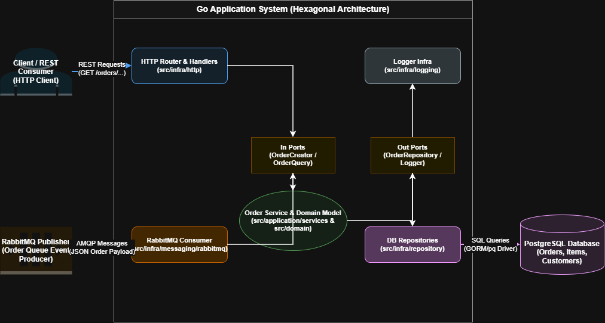

# Desafio Backend BTG Pactual - Processamento de Pedidos

Serviço em **Go (Golang)** desenvolvido para processamento assíncrono e consulta de pedidos de clientes, aplicando os conceitos de **Arquitetura Hexagonal (Ports & Adapters)**, mensageria com **RabbitMQ** e persistência em banco de dados **PostgreSQL**.

## Tecnologias Utilizadas

- **Linguagem:** Go (Golang)
- **Mensageria:** RabbitMQ (AMQP)
- **Banco de Dados:** PostgreSQL
- **Orquestração:** Docker & Docker Compose
- **Arquitetura:** Hexagonal / Ports & Adapters

## Arquitetura do Projeto

O projeto segue a separação de responsabilidades alinhada à Arquitetura Hexagonal (Ports & Adapters):



### Estrutura de Pastas

```
├── arquitetura/
│   └── DesafioBackEndBTG.drawio.png # Diagrama de Arquitetura do Sistema
├── cmd/
│   └── main.go               # Ponto de entrada da aplicação
├── sql/
│   └── init.sql              # Scripts SQL de inicialização do PostgreSQL
├── src/
│   ├── domain/               # Entidades de domínio e regras de negócio
│   ├── application/
│   │   ├── ports/            # Portas de entrada (In) e saída (Out)
│   │   └── services/         # Casos de uso / Serviços da aplicação
│   └── infra/
│       ├── db/               # Conexão com Banco de Dados
│       ├── http/             # Handlers e Rotas HTTP
│       ├── logging/          # Implementação do Logger
│       ├── messaging/        # Consumidor RabbitMQ
│       └── repository/       # Implementação dos Repositórios
└── test/                     # Testes unitários e de integração
```

## Como Executar a Aplicação

### Pré-requisitos

- [Docker](https://www.docker.com/) e [Docker Compose](https://docs.docker.com/compose/) instalados.

### Passos para execução

1. Clone este repositório:
   ```bash
   git clone <URL_DO_REPOSITORIO>
   cd Desafio-Backend-BTG-Pactual
   ```

2. Suba os containers (PostgreSQL, RabbitMQ e a Aplicação em Go):
   ```bash
   docker-compose up --build -d
   ```

3. Verifique os logs da aplicação:
   ```bash
   docker-compose logs -f app
   ```

## Endpoints da API

A API fica disponível por padrão na porta `:8080`.

### 1. Consultar Valor Total do Pedido

Calcula e retorna o valor total acumulado de um pedido específico.

- **URL:** `GET /orders/{order_id}/total`
- **Exemplo de Resposta (200 OK):**
  ```json
  {
    "order_id": 1001,
    "total_value": 150.50
  }
  ```

### 2. Consultar Quantidade de Pedidos por Cliente

Retorna a quantidade total de pedidos realizados por um cliente.

- **URL:** `GET /customers/{customer_id}/orders/count`
- **Exemplo de Resposta (200 OK):**
  ```json
  {
    "customer_id": 42,
    "total_orders": 5
  }
  ```

### 3. Listar Pedidos de um Cliente

Retorna a lista paginada ou completa dos pedidos vinculados a um cliente.

- **URL:** `GET /customers/{customer_id}/orders`
- **Exemplo de Resposta (200 OK):**
  ```json
  [
    {
      "order_id": 1001,
      "total_value": 150.50,
      "items": [
        {
          "product": "item-A",
          "quantity": 2,
          "price": 50.00
        },
        {
          "product": "item-B",
          "quantity": 1,
          "price": 50.50
        }
      ]
    }
  ]
  ```

## Processamento de Mensagens (RabbitMQ)

A aplicação consome mensagens JSON enviadas para a fila do RabbitMQ.

**Estrutura de mensagem esperada na fila:**

```json
{
  "codigoPedido": 1001,
  "codigoCliente": 42,
  "itens": [
    {
      "produto": "Caderno",
      "quantidade": 2,
      "preco": 25.00
    }
  ]
}
```

## Testes

Para executar a suíte de testes unitários e de integração:

```bash
go test ./test/... -v
```

## Licença

Este projeto foi desenvolvido como resolução do Desafio Backend BTG Pactual.
